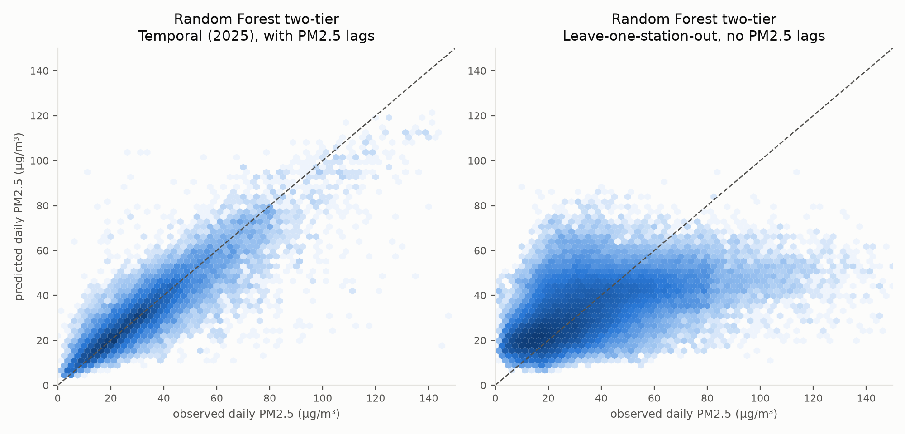
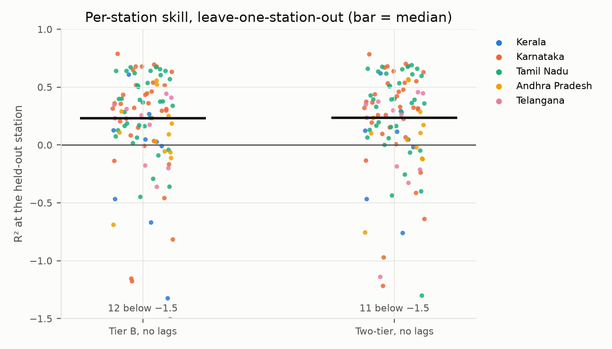
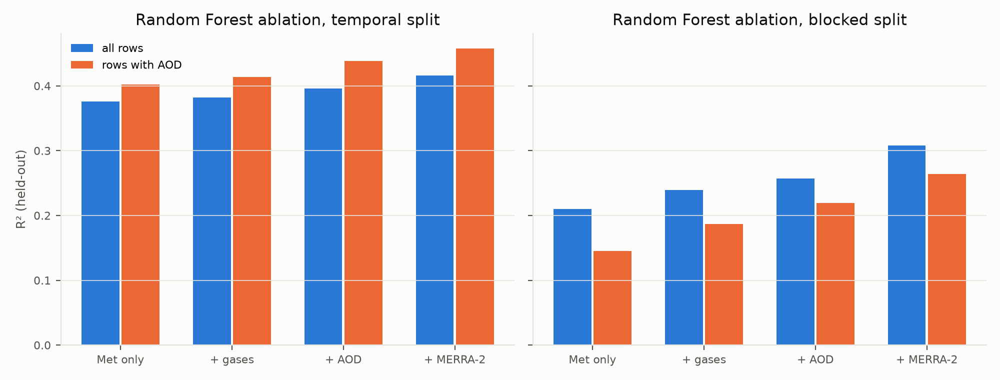
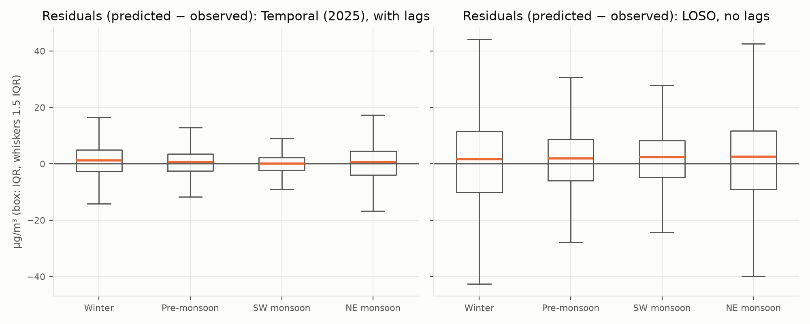
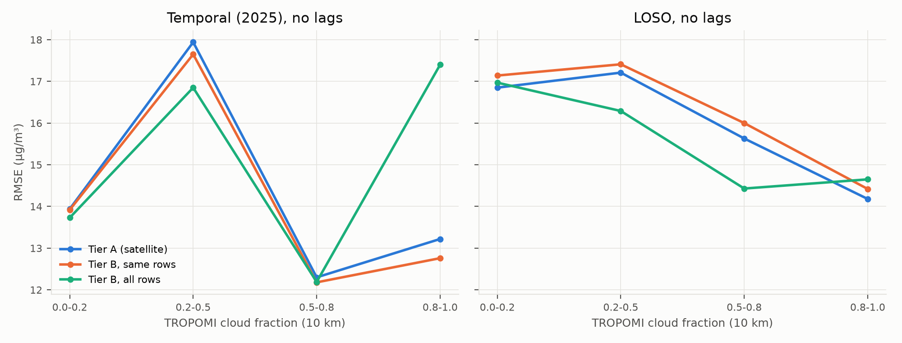

# Phase 1 report: satellite-based ground-level PM2.5 in South India

**Status: Phase 1 COMPLETE, signed off 2026-11-04 (D038–D043 decided). QC rule S3a-12h adopted
(D028 review); all results are from dataset v2.**
Every number below comes from a file in `reports/tables/` or the dataset's data card, and can be
regenerated with `python -m src.run stage5` (after `stage2` and `stage4`). Stage details are in
`station_audit.md`, `stage2_acquisition.md`, `stage3_exploration.md`, `feasibility_summary.md`
and `stage4_cleaning_features.md`; every decision is in `decision_log.md`.

## 1. Question and design

How much do cloud cover and the monsoon degrade satellite-based daily PM2.5 estimation in
South India, and how much does a two-tier model recover?

- **Tier A:** satellite gases (TROPOMI) and AOD (MAIAC), plus reanalysis aerosol (MERRA-2),
  meteorology (ERA5-Land / ERA5), static and temporal features. 43 features.
- **Tier B:** the same without satellite inputs, usable on cloudy days. 31 features.
- **Two-tier:** Tier A where MAIAC AOD exists within 10 km, otherwise Tier B (D039).

Each tier is run with and without PM2.5 lags (D037). The lag versions need yesterday's
measurement at the same station, so they describe gap filling at a monitored site. **The no-lag
versions are the honest measure for unmonitored locations**, which is what a satellite map is for.

## 2. Scope decisions

| Decision | Choice |
|---|---|
| Study area (D010) | Kerala, Karnataka, Tamil Nadu, Andhra Pradesh, Telangana; Kerala reported separately as the monsoon focus |
| Period (D011) | 2021-01-01 to 2025-12-31 (extraction from 2020-12-01 for lags, D023) |
| Valid day (D012) | ≥ 18 of 24 hourly values |
| Headline station set (D013) | stations with valid days on ≥ 70 % of the period (43 stations; ≥ 50 %: 56) |
| Seasons (D014) | IMD: winter Jan–Feb, pre-monsoon Mar–May, SW monsoon Jun–Sep, NE monsoon Oct–Dec |
| Ground sources (D008, D009, D015) | CPCB CCR hourly (manual download); OpenAQ only for the two US Consulate monitors |
| Time convention (D024) | CPCB labels are IST hour-start (checked against OpenAQ UTC, median r 0.986) |
| Satellite products (D022, D027, D029, D030) | TROPOMI OFFL L3 (Earth Engine, pre-filtered); MAIAC "clear" AOD; no extra cloud filter |
| Reanalysis (D019, D020) | MERRA-2 reconstructed PM2.5 and AOD; ERA5-Land with ERA5 fallback; ERA5 BLH |
| Static (D025, D033) | SRTM, ESA WorldCover, WorldPop, distance to coast; road density dropped |
| Sampling (D026, D031, D035) | station points only (grid pending); 10 km buffer mean; no minimum pixel count |
| Target (D034, D036) | daily IST mean is primary; 12–15 IST overpass mean is in the dataset as secondary |

## 3. Data summary

- **Ground:** 2,995,590 hourly values (CPCB 2,916,244; US Consulates 79,346) at 120 located
  stations, 2020-12 to 2025-12.
- **Satellite and reanalysis:** Earth Engine extracts for 120 points (TROPOMI, MAIAC, ERA5-Land, ERA5, MERRA-2, static), every raw file hashed in
  `reports/tables/data_manifest.csv`.
- **Coverage on valid PM2.5 days** (Stage 3, `eda_feasibility.csv`): MAIAC AOD at the station
  pixel 32.5 %, within 10 km 54.9 %; NO2 within 10 km 68.9 %. Kerala SW monsoon: AOD at the
  pixel 11.8 %, within 10 km 36.9 %. Gaps follow cloud: AOD at the pixel exists on 71 % of
  clear days and 1 % of overcast days.

## 4. Cleaning outcomes

QC rules S3a-12h (D028, revised after the Stage 5 sensitivity run), from `cleaning_log.csv`.
No row is deleted; each hour carries a flag.

| Rule | Hours removed |
|---|---|
| Negative / zero / exactly 1000 | 17 / 58 / 2 |
| Flat run ≥ 12 h | 16,334 |
| Isolated spike (1–2 h, > 4 × centred 25 h median and > 100 µg/m³) | 3,907 |
| **Total** | **20,318 of 2,995,590 (0.68 %)** |

The flat-line threshold was 24 h when Stage 4 was signed off (rule S3a, 12,967 hours, dataset
v1). It was lowered to 12 h after the Stage 5 sensitivity run showed that 12–23 h runs of
identical values look like stuck instruments (7,370 hours; round values such as 45.0 repeated
379 times; values above 100 µg/m³ 3.5 times more common than elsewhere). **This change was made
after seeing its effect on model skill**, so the 24 h results are reported alongside (7.5).

Dataset `pm25_dataset_v2.parquet`: 126,830 station-days at 113 stations, 113,295 with a valid
daily target and 124,149 with a valid overpass target (`dataset_reconciliation.csv`).
The two targets agree closely (Spearman ρ 0.885).

## 5. Features

| Group | Columns | Tier |
|---|---|---|
| Satellite | TROPOMI NO2, CO, SO2, HCHO, UV aerosol index, cloud fraction; MAIAC AOD; valid-pixel counts and availability flags (10 km) | A |
| Reanalysis aerosol | MERRA-2 PM2.5 and AOD | A, B |
| Meteorology | T2m, RH, u10, v10, wind speed, precipitation, BLH | A, B |
| Lags | PM2.5 1–3 days (dropped in `_nolag`); meteorology 1 day; precipitation 2–3 days | A, B |
| Temporal | day-of-year sin/cos, month, season | A, B |
| Static | elevation, distance to coast, land-cover shares, population | A, B |

Missing satellite values stay missing (Random Forest handles NaN natively; linear regression
uses medians fitted on the training rows).

## 6. Evaluation framework

`src/eval/` (configured in `configs/experiments.yaml`):

| Split | Train | Test |
|---|---|---|
| Temporal | 2021–2024 | 2025 |
| Spatially blocked (D038) | 4 of 5 folds of 46 blocks (stations linked within 50 km) | the 5th fold |
| Leave-one-station-out (LOSO) | all other stations | one station |
| Combined | other blocks, 2021–2024 | held-out blocks, 2025 |

- **Metrics:** RMSE, MAE, R², bias and Pearson r, on pooled held-out rows. They are reported
  overall, by season, by cloud-fraction bin (D041), by station and for Kerala Jun–Sep.
- **Baselines:** persistence (yesterday's value; temporal split only), climatology (station ×
  month, falling back to state × month), linear regression, and Random Forest (fixed settings, D040).
- **Leakage controls:** tests check that no station, block or year appears on both sides. All
  preprocessing is fitted on training rows, and lags are calendar lags.

## 7. Baseline results

### 7.1 Overall (`results_overall.csv`, `results_station_sets.csv`)

Random Forest, held-out R² (RMSE in µg/m³). All 113 stations; the D013 headline set
(43 stations) is in brackets.

| Model | Temporal | Blocked | LOSO | Combined |
|---|---|---|---|---|
| Climatology | 0.29 (0.40) | 0.18 (0.21) | 0.23 (0.28) | 0.13 (0.18) |
| Two-tier, with lags | 0.65 (0.74), 11.7 | 0.74 (0.78), 9.8 | 0.75 (0.79), 9.7 | 0.64 (0.73), 11.9 |
| Two-tier, no lags | 0.41 (0.54), 15.3 | 0.31 (0.37), 16.0 | 0.32 (0.38), 15.9 | 0.20 (0.30), 17.8 |
| Linear two-tier, no lags | 0.24 (0.39) | 0.34 (0.43) | 0.35 (0.43) | 0.22 (0.37) |

- **PM2.5 lags carry most of the skill.** Persistence alone reaches R² 0.59 in 2025. On the
  same 24,571 rows, the two-tier RF with lags reaches 0.73, RMSE 10.0 against 12.3
  (`results_persistence_rows.csv`).
- **Without lags, skill at an unseen station is low:** LOSO R² 0.32, against 0.23 for
  climatology. This matches the Stage 3 finding that stations within 10 km correlate only at
  median ρ 0.49.
- **Linear regression and the RF are indistinguishable in the spatial no-lag splits.** LOSO R²
  is 0.35 against 0.32, but the difference is not significant: RF − linear −0.032, 95 % CI
  [−0.107, +0.038] (`results_ci.csv`). In the temporal split the RF is clearly better
  (+0.167, CI [+0.094, +0.250]).
- **Per station (LOSO, no lags):** median R² 0.24. It is below 0 at 34 of 113 stations and below
  −1.5 at 11. Medians by state: Tamil Nadu 0.36, Karnataka 0.31, Andhra Pradesh 0.10, Kerala 0.05,
  Telangana −0.19.

### 7.2 What the satellite adds (Tier A against Tier B on the same rows)

RF R² on the 62,342 rows where MAIAC AOD exists within 10 km (15,374 in the 2025 test set):

| Split | Tier A, no lags | Tier B, no lags, same rows | Tier A, lags | Tier B, lags, same rows |
|---|---|---|---|---|
| Temporal | 0.447 | 0.455 | 0.708 | 0.712 |
| Blocked | 0.277 | 0.266 | 0.756 | 0.756 |
| LOSO | 0.275 | 0.251 | 0.764 | 0.764 |
| Combined | 0.204 | 0.200 | 0.697 | 0.698 |

- **With MERRA-2 and meteorology already in the model, the satellite inputs add little.** At an
  unseen station (LOSO, no lags) Tier A beats Tier B on the same rows by +0.024 R²
  (95 % CI [+0.006, +0.041]), and by +0.050 [+0.023, +0.086] in the SW monsoon. In the blocked
  split the gain is smaller and not significant: +0.011 [−0.014, +0.030], SW monsoon +0.019
  [−0.020, +0.082]. There is no gain in the temporal split (−0.008 [−0.017, −0.000]) or with
  PM2.5 lags (|Δ| ≤ 0.008 everywhere; in the SW monsoon Tier A is slightly worse, −0.007 to −0.008).
- **The blocked-split gain depends on the QC rule.** Under the 24 h rule it was +0.022
  [+0.009, +0.035] (7.5). So the satellite inputs helped most on the error-heavy days that the
  12 h rule now removes as suspected stuck-instrument data. That makes the blocked-split gain fragile.
- **The ablation explains why the gain is small** (`results_ablation.csv`; RF, no lags, blocked
  split, rows with AOD). R² rises from 0.16 (met only) to 0.20 (+ gases), 0.23 (+ AOD) and
  0.27 (+ MERRA-2). The satellite inputs do carry signal, about +0.07 R² over meteorology alone,
  but MERRA-2 overlaps with most of it.

### 7.3 Cloud and the monsoon

**By cloud fraction** (`results_by_cloud.csv`, RF, no lags, LOSO):

| Cloud fraction | Rows | RMSE, Tier B (all rows) | Rows with AOD | RMSE, Tier A | RMSE, Tier B (same rows) |
|---|---|---|---|---|---|
| 0.0–0.2 | 41,159 | 17.0 | 36,590 | 16.9 | 17.1 |
| 0.2–0.5 | 27,471 | 16.3 | 15,168 | 17.2 | 17.4 |
| 0.5–0.8 | 16,360 | 14.4 | 4,636 | 15.6 | 16.0 |
| 0.8–1.0 | 23,945 | 14.7 | 2,093 | 14.2 | 14.4 |

- **AOD almost disappears under cloud.** Above cloud fraction 0.8, Tier A covers 2,093 of
  23,945 rows (9 %). The two-tier system is therefore almost entirely Tier B on cloudy days.
- **Absolute RMSE falls with cloud**, because cloudy days are mostly monsoon days with low
  PM2.5. Where Tier A exists, its advantage over Tier B stays at 0.2–0.4 µg/m³ RMSE in every bin.
  So cloud removes the satellite's coverage more than it degrades the satellite's skill.
- **The temporal split's 0.8–1.0 bin with AOD is small** (578 rows), so its numbers are noisy.

**By season** (`results_by_season.csv`, temporal 2025, RF two-tier no lags): R² is 0.37 in
winter, 0.19 pre-monsoon, 0.26 SW monsoon and 0.37 NE monsoon. With lags it is 0.62, 0.49, 0.73
and 0.59. In the SW monsoon, RMSE is lowest (10.1 µg/m³ without lags) because concentrations
are low.

**Kerala, June–September** (`results_kerala_jjas.csv`; 3,230 station-days, 1,195 with AOD):

| Model (LOSO) | R² | RMSE |
|---|---|---|
| Climatology | −0.06 | 12.4 |
| Two-tier RF, no lags | −0.10 | 12.6 |
| Tier A RF, no lags (AOD rows) | −0.05 | 12.3 |
| Two-tier RF, with lags | 0.54 | 8.1 |

Without the station's own recent measurements, no model beats a monthly mean in the Kerala
monsoon. This confirms the Stage 3 finding that no predictor correlates with PM2.5 there
at |ρ| > 0.1.

### 7.4 Confidence intervals (D043, `results_ci.csv`)

Intervals come from 1,000 resamples of the 46 spatial blocks. Model differences are
bootstrapped on the same rows.

- **Absolute R² is uncertain because blocks differ a lot.** Two-tier without lags: LOSO 0.32
  [0.25, 0.38], temporal 0.41 [0.29, 0.54]. Tier A with lags (AOD rows): LOSO 0.76 [0.71, 0.80].
- **Differences between models on the same rows are much tighter.** The comparisons in 7.1–7.2
  are reported with these paired intervals.
- **Against the simple baselines:** the RF beats climatology without lags (LOSO +0.091
  [+0.004, +0.166]) and persistence with lags (temporal +0.136 [+0.050, +0.264]).
- **In the SW monsoon the no-lag model is no better than climatology** (blocked −0.022
  [−0.182, +0.058], LOSO +0.004 [−0.077, +0.082]).

### 7.5 Sensitivity to the Stage 4 choices (D042, `results_sensitivity.csv`)

Random Forest, no PM2.5 lags. "Δ" is Tier A − Tier B on the variant's Tier A rows, with a 95 %
block-bootstrap CI.

| Variant | Tier A rows (blocked) | Δ R², blocked | Δ R², temporal | Two-tier R², blocked / temporal |
|---|---|---|---|---|
| Main (S3a-12h; clear AOD, 10 km, no filters) | 62,342 | +0.011 [−0.014, +0.030] | −0.008 [−0.017, −0.000] | 0.314 / 0.410 |
| MAIAC "best" QA (D029) | 54,249 | +0.016 [−0.013, +0.038] | −0.007 [−0.020, +0.005] | 0.316 / 0.411 |
| Station pixel (D035) | 36,758 | +0.029 [+0.007, +0.051] | −0.012 [−0.034, +0.006] | 0.318 / 0.411 |
| 5 km buffer (D035) | 55,013 | +0.026 [+0.010, +0.038] | −0.016 [−0.035, +0.001] | 0.321 / 0.407 |
| No satellite when cloud > 0.3 (D030) | 47,569 | +0.012 [−0.020, +0.039] | −0.006 [−0.021, +0.006] | 0.313 / 0.412 |
| ≥ 10 % valid pixels (D031) | 51,129 | +0.012 [−0.020, +0.035] | −0.013 [−0.028, −0.000] | 0.313 / 0.409 |
| ≥ 25 % valid pixels (D031) | 45,160 | +0.018 [−0.010, +0.042] | −0.011 [−0.028, +0.004] | 0.315 / 0.410 |
| Overpass target 12–15 IST (D036) | 67,753 | +0.023 [+0.010, +0.043] | +0.010 [−0.002, +0.020] | 0.208 / 0.248 |
| QC S3a, flat-line ≥ 24 h (D028, dataset v1) | 62,544 | +0.022 [+0.009, +0.035] | −0.007 [−0.015, −0.001] | 0.290 / 0.341 |

- **The spatial satellite gain is small, positive in every variant, and fragile.** Δ ranges
  from +0.011 to +0.029 in the blocked split, but its CI excludes zero only for the station
  pixel, the 5 km buffer, the overpass target and the 24 h QC rule. There is no temporal gain
  in any variant. No buffer, QA or filter choice is clearly better than the main one. Under the
  24 h rule the station pixel was the weakest variant (+0.008 [−0.012, +0.026]), so the ranking
  between geometries is not stable either.
- **The overpass target is much harder to predict** than the daily mean: two-tier R² 0.21–0.25
  without lags and 0.42–0.45 with lags, because a 3-hour mean is noisier. The satellite gain is
  similar, so it does not favour the satellite-matched target.
- **The QC rule changes absolute skill more than any satellite choice.** The 24 h rule (S3a,
  the rule at Stage 4 sign-off) gives temporal R² 0.34 instead of 0.41 without lags, and 0.58
  instead of 0.65 with lags. The 12 h rule removes 432 of 113,727 daily targets (0.4 %); those
  days carry 11–30 % of the squared error, including one at 770 µg/m³. The variant rebuilds the
  whole dataset under the 24 h rule and reproduces dataset v1 exactly (D028 review).

### 7.6 Headline answer for Phase 1

1. Cloud and the monsoon act mainly by **removing** satellite coverage: AOD exists on 9 % of
   days with cloud fraction > 0.8 and on 37 % of Kerala monsoon days within 10 km.
2. Where satellite data exist and MERRA-2 and meteorology are already in the model, they add
   only a small amount of skill at unmonitored locations. In LOSO the gain is +0.024 R²
   [+0.006, +0.041], and +0.050 [+0.023, +0.086] in the SW monsoon. In the blocked split it is
   +0.011 to +0.029 across variants, often with a CI that includes zero. They add nothing for gap
   filling at a monitored station.
3. **Tier B therefore recovers essentially all of the two-tier skill.** For an unmonitored
   location, though, that skill is low: LOSO R² 0.32 (0.38 on the 43 headline stations), and
   no skill in the Kerala monsoon.

## 8. Limitations

- **Point extraction only.** No 1 km grid yet (D026). The 10 km buffer smooths the satellite
  signal, which may understate what a pixel-level model could do.
- **Untuned baselines** (D040). Tuning, gradient boosting and spatial features such as
  neighbour-station values or distance-weighted PM2.5 are Phase 2 work.
- **Sensitivity coverage.** The sensitivity runs (7.5) use the Random Forest on the temporal
  and blocked splits only. LOSO and linear regression were not rerun.
- **QC rule chosen after seeing results.** The 12 h flat-line rule was adopted after the
  sensitivity run showed it raises skill (D028 review). The case for it is instrument plausibility,
  but the 24 h results are reported alongside (7.5) and change absolute R² by up to 0.07.
- **Bootstrap clusters.** The bootstrap resamples spatial blocks only. In the temporal split,
  errors are also correlated across days, so those intervals may still be somewhat narrow.
- **Uneven station coverage.** Kerala has 9 stations (6 at ≥ 70 %), so its per-state numbers rest
  on few sites. Several Tamil Nadu and Andhra Pradesh stations start in 2024, so they have little
  training data in the temporal split.
- **Pooled metrics.** R² is computed on pooled held-out rows, so it mixes between-station and
  within-station variance. Per-station metrics are in `results_by_station.csv`.
- **Data caveats.** CPCB may still revise 2025 data. Earth Engine MERRA-2 is missing 6 days in
  September 2025. TROPOMI L3 uses Google's fixed pre-filter (D027).

## 9. Proposed for Phase 2

1. Test whether the spatial satellite gain survives better models (tuning, gradient boosting),
   since its sign is consistent but its size is within block-to-block noise.
2. Add spatial predictors for unmonitored sites (inverse-distance PM2.5 from other stations on
   the same day; this needs care to avoid leakage in LOSO).
3. Tune models with nested validation, and add gradient boosting.
4. Extract the 1 km grid (D026) and produce maps.
5. Develop the Kerala monsoon case separately, for example with longer-range transport,
   rainfall-washout features or a different target scale.
