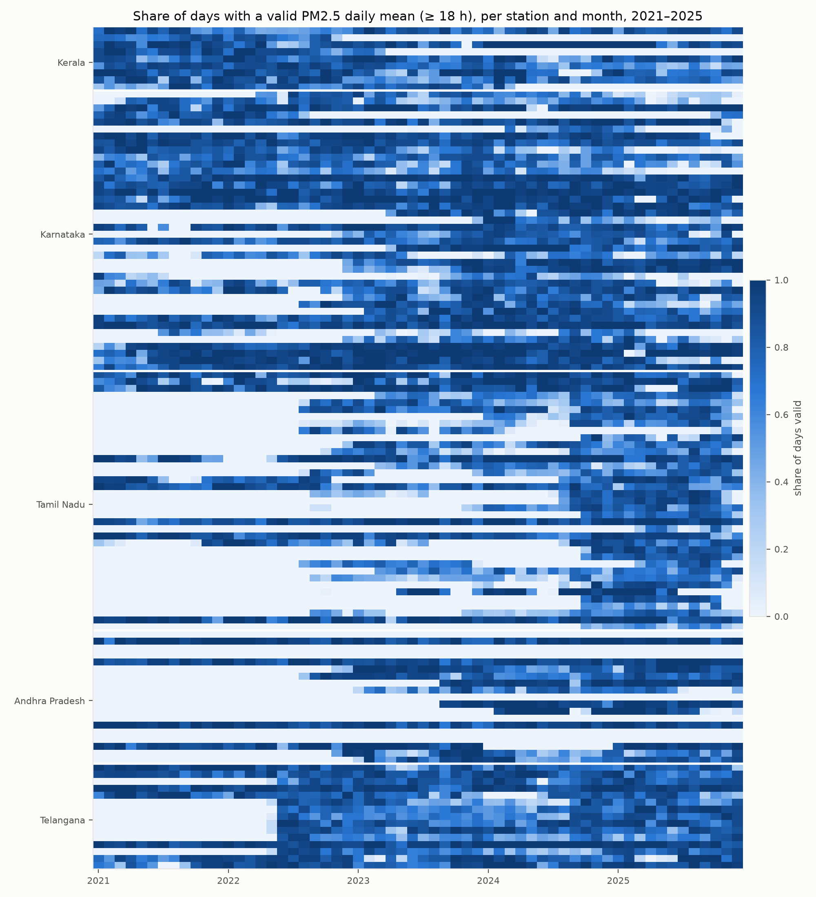
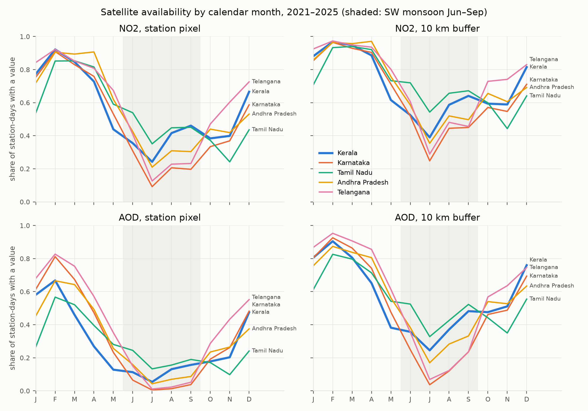
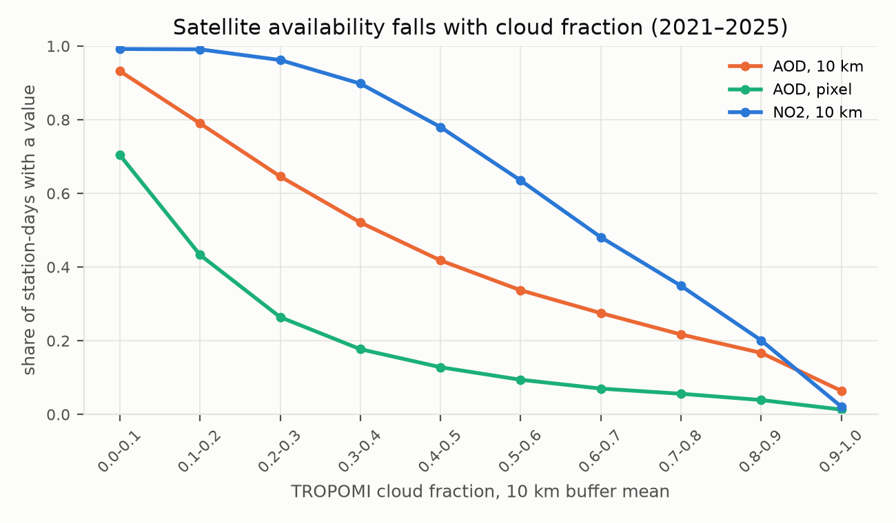
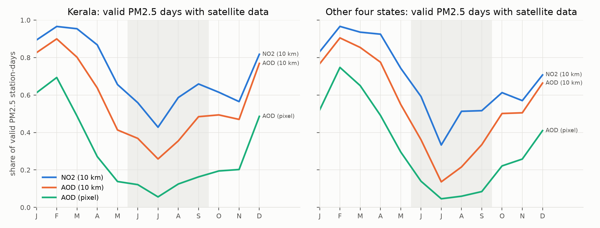
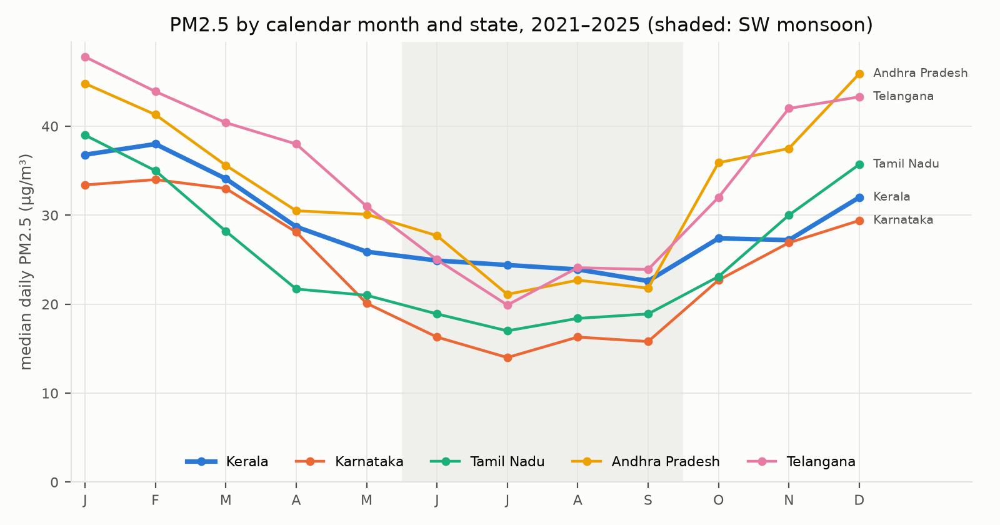
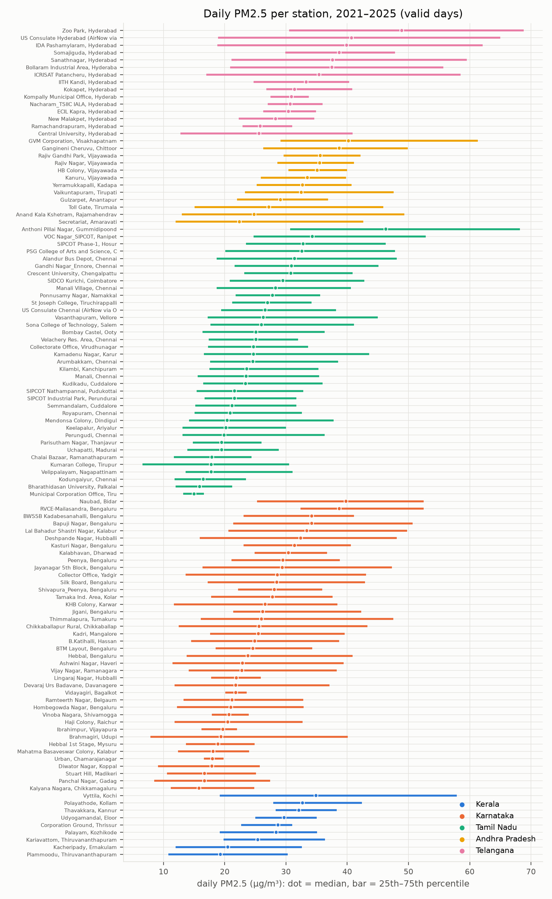
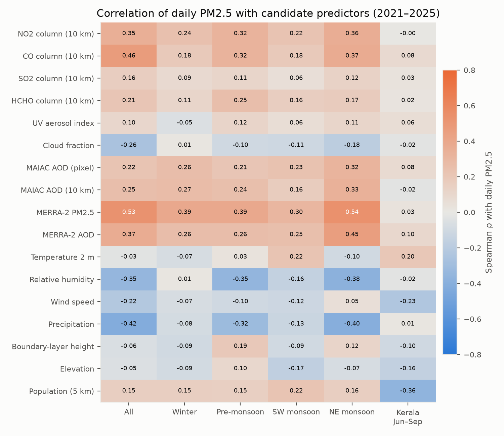
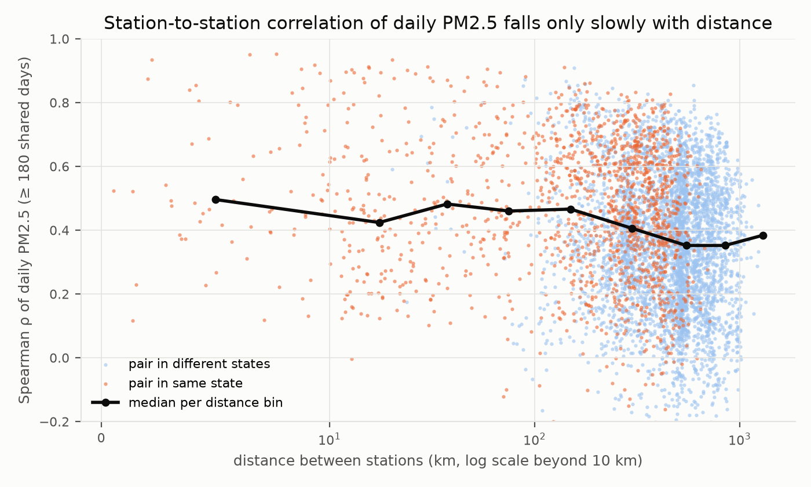

# Stage 3: exploratory analysis

**Status: COMPLETE, signed off.** Period: study period 2021-01-01 to 2025-12-31 (D011).
Unit of analysis: station-day (IST calendar day). No QC has been applied: the data are
described as received. Every number comes from a table in `reports/tables/`.
Regenerate: `python -m src.run stage3`.

**Updated 2026-11-05 (dataset v3 rerun, D044).** The tables were regenerated with the duplicated
US Consulate hours removed (D044) and with the 3 stations located in Stage 4 (D032), so they now
cover 120 stations instead of 117. The numbers below are the regenerated ones; none of the
conclusions changed. Problem 14 is corrected.

Pipeline: `src/eda/build_daily.py` builds an exploratory station-day table
(`data/interim/eda_daily.parquet`: 120 stations × 1,857 days = 222,840 rows, 87 columns).
This is for exploration only; the analysis-ready dataset is built in Stage 4.
`missingness.py`, `pm25_patterns.py` and `data_quality.py` produce the tables and figures below.

## 1. Missingness (task 2)

Share of station-days missing over the full 2021–2025 grid (`eda_missing_by_variable.csv`).
A station that had not started yet counts as missing.

| Variable | Station pixel | 5 km | 10 km |
|---|---|---|---|
| PM2.5 valid day (≥ 18 h) | 0.479 | | |
| TROPOMI NO2 | 0.471 | 0.365 | 0.310 |
| TROPOMI CO | 0.401 | 0.278 | 0.224 |
| TROPOMI SO2 | 0.483 | 0.389 | 0.333 |
| TROPOMI HCHO | 0.379 | 0.291 | 0.243 |
| TROPOMI UV aerosol index | 0.002 | 0.002 | 0.002 |
| MAIAC AOD (clear) | 0.691 | 0.524 | 0.459 |
| MAIAC AOD (best quality) | 0.749 | 0.594 | 0.530 |
| ERA5/ERA5-Land meteorology, BLH | 0.000 | | |
| MERRA-2 PM2.5 and AOD | 0.001 | | |

**PM2.5 coverage** (figure above, `eda_missing_by_station.csv`). Many Tamil Nadu and Andhra Pradesh
stations start in 2022–2024. Kerala and Karnataka stations are mostly complete from 2021.

**Satellite availability by month** (`eda_sat_availability_month_state.csv`). All states share
the same pattern: high from January to April, a deep minimum in July, partial recovery
from October. MAIAC AOD at the station pixel drops to 0–5 % of station-days in July in
every state except Tamil Nadu (13 %), whose east coast gets less SW-monsoon rain. Tamil Nadu has its own dip in November
(NE monsoon). The 10 km buffer roughly doubles to triples AOD availability in the monsoon.

**Mechanism** (`eda_aod_vs_cloud.csv`). MAIAC AOD availability at the pixel falls from 70 %
on clear days (TROPOMI cloud fraction < 0.1) to 1 % on overcast days (≥ 0.9). TROPOMI NO2
at the pixel falls from 99 % to 0 %. The UV aerosol index is retrieved under cloud and is
always present, so it carries no missingness signal (but see §3: it is also weakly
related to PM2.5).

## 2. Feasibility: how many PM2.5 days have satellite data (task 5)

See the one-page summary: [`feasibility_summary.md`](feasibility_summary.md).

## 3. PM2.5 patterns and correlations (task 3)

**Seasonality** (`eda_pm25_season_state.csv`, median daily PM2.5 in µg/m³):

| State | Winter | Pre-monsoon | SW monsoon | NE monsoon |
|---|---|---|---|---|
| Kerala | 37.9 | 30.0 | 24.0 | 29.1 |
| Karnataka | 33.7 | 26.5 | 15.6 | 26.0 |
| Tamil Nadu | 36.7 | 23.2 | 18.3 | 28.4 |
| Andhra Pradesh | 42.5 | 32.2 | 23.6 | 39.1 |
| Telangana | 45.9 | 36.3 | 23.2 | 38.7 |

PM2.5 is lowest in the SW monsoon everywhere. Kerala has the *flattest* seasonal cycle:
in the monsoon it stays near 24 µg/m³ while Karnataka falls to 16. So the months where
satellite data are scarcest are also the months with the smallest PM2.5 signal, except in Kerala.

**Distribution** (`eda_pm25_by_station.csv`): 113 stations have valid days in 2021–2025;
station medians range from 15.0 to 48.9 µg/m³ (median of medians 26.3). Maxima of up to
957 µg/m³ at stations with a median near 30 are spike candidates (§4).

**Correlation with candidate predictors** (`eda_correlation_spearman.csv`, Spearman ρ, pairwise complete):

- Overall, the strongest single predictors are MERRA-2 PM2.5 (0.53), TROPOMI CO (0.46),
  precipitation (−0.42), MERRA-2 AOD (0.37), NO2 (0.35) and RH (−0.35). MAIAC AOD is weaker
  (0.22 pixel, 0.25 at 10 km) than the gases and the reanalysis.
- Much of the overall correlation is the shared seasonal cycle: within seasons the values
  are lower (e.g. MERRA-2 0.30–0.54, NO2 0.22–0.36).
- **Kerala in June–September: almost nothing correlates with daily PM2.5** (|ρ| ≤ 0.10 for all
  satellite and reanalysis aerosol variables). The largest are population (−0.36, a
  between-station difference), wind speed (−0.23) and temperature (0.20). This is the
  hardest case for the thesis and should be stated plainly as a finding.
- Boundary-layer height (daily mean) is only weakly related (−0.06 overall). A daytime or
  overpass-window BLH may behave differently; this is tested in Stage 4.

**Station-to-station correlation** (`eda_station_pairs.csv`, 5,594 pairs with ≥ 180 shared days,
Spearman ρ of daily PM2.5): median 0.50 for pairs within 10 km, 0.45–0.47 up to 200 km,
0.35 beyond 400 km. Correlation falls only slowly with distance, and even nearby stations
agree weakly day to day. Strong local variation (and un-QC'd spikes) limits how well a
neighbouring station, or a 1 km satellite pixel, can predict a given station: expect
leave-one-station-out scores to be well below random-split scores.

## 4. Data quality problems and proposed handling (task 4)

Counts from `eda_qc_summary.csv`, `eda_qc_by_station.csv`, `eda_qc_gaps.csv` (hourly ground data
2021–2025, 2.93 M station-hours). Nothing has been removed; the rules are decided in Stage 4.

| # | Problem | Size | Proposed handling (Stage 4, to be approved) |
|---|---|---|---|
| 1 | Negative PM2.5 | 17 hours, 2 stations (US Consulates) | Remove (physically impossible) |
| 2 | PM2.5 exactly 0 | 39 hours, 2 stations | Remove (below detection; likely fill value) |
| 3 | Very high hourly PM2.5 > 500 µg/m³ | 1,823 hours, 69 stations | Keep unless also a spike or flat-line; Diwali/fireworks nights are real |
| 4 | Value exactly 1000 µg/m³ | 2 hours, 1 station | Remove (instrument ceiling) |
| 5 | Flat-lined sensor: identical value for ≥ 24 consecutive hours | 8,898 hours, 53 stations (≥ 6 h: 26,369 h, 94 stations) | Remove runs ≥ 24 h; flag 6–23 h and test sensitivity |
| 6 | Spike: > 4 × centred 25 h median and > 100 µg/m³ | 5,530 hours, 103 stations | Remove isolated spikes (1–2 h); keep multi-hour episodes |
| 7 | Station outages ≥ 7 days | 899 outages, 21,910 days, 108 stations; 39 % of outage days fall in Jun–Sep (33 % of the calendar) | Keep as missing. Outages are monsoon-biased: report it, and never impute the target |
| 8 | Stations starting part-way (TN, AP from 2022–2024) | see heatmap | Keep; the temporal split (train ≤ 2024, test 2025) must account for stations with no training years |
| 9 | Negative SO2 columns | 39 % of 10 km means | SO2 is mostly noise over South India at this scale: keep as a feature but expect little; do not clip |
| 10 | Negative NO2 / HCHO columns | 0.2 % / 2.0 % | Keep (valid retrievals near zero); do not clip |
| 11 | MAIAC AOD > 3 | 5 station-days | Keep; check against smoke/dust events |
| 12 | MERRA-2 missing 6 days (Sep 2025) | 144 hours | Leave missing; tree models handle NaN |
| 13 | ERA5-Land missing at 9 coastal stations (7 of the original 117, plus 2 located in Stage 4) | 7.5 % of station-days | Already filled from ERA5 in the EDA table; record the source per row (done: `met_land_share`) |
| 14 | US Consulate hours: until October 2024 OpenAQ returns most hours twice, as bins starting at :00 and :30 IST (the Stage 3 text called this an offset) | 2 stations, 30,111 duplicate hours | **Corrected in D044:** keep one record per IST hour (the :00 bin). The duplicates had made 67 daily targets wrongly valid; daily means changed by a median of 0 µg/m³ (max 8.7) |
| 15 | Bollaram coordinates differ by 3.6 km between sources | 1 station | Keep OpenAQ value; exclude from 5 km buffer sensitivity if results differ |

## 5. Data dictionary (task 1)

Completed in [`data_dictionary.md`](data_dictionary.md): every raw dataset and every derived
EDA variable with source, unit, resolution, coverage and known issues.
