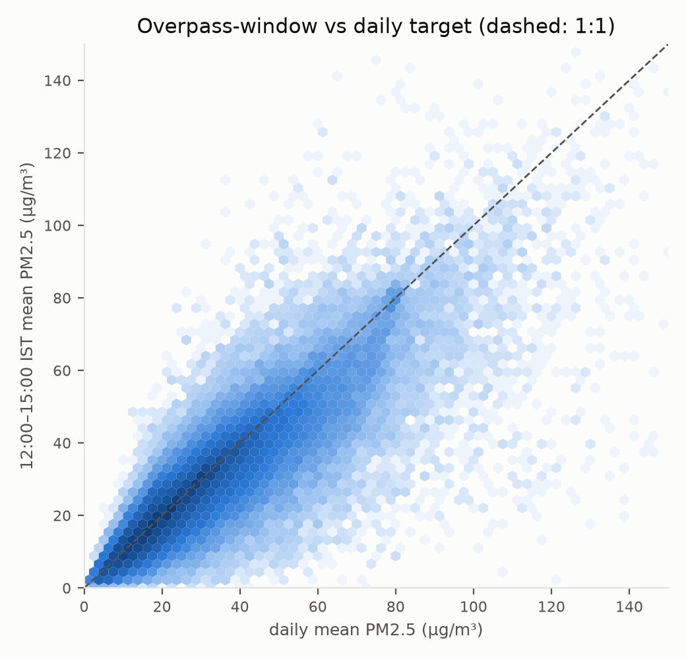
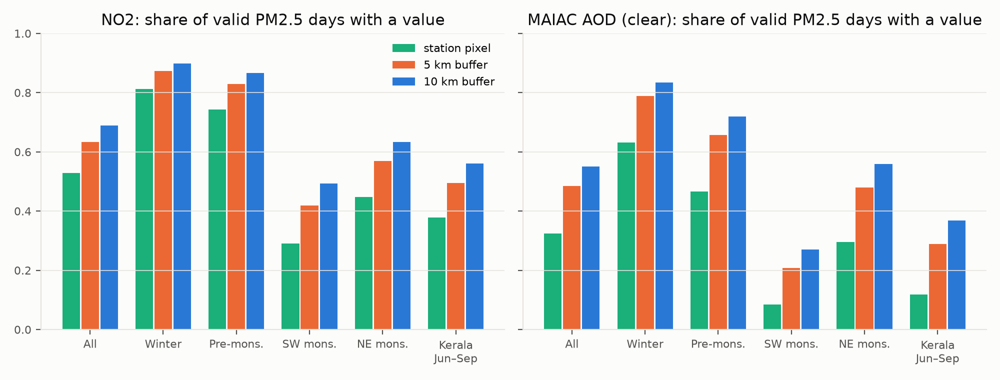

# Stage 4: cleaning, alignment, features

**Status: COMPLETE, awaiting sign-off** (D034–D037 proposed). Regenerate with
`python -m src.run stage4` (after `python -m src.run stage2` for raw data).
Every number comes from a file in `reports/tables/` or the dataset's data card.

## 1. Deliverable

`data/processed/pm25_dataset_v1.parquet` with data card `pm25_dataset_v1.json`
(rows, columns, SHA-256 `f107804bd13055b6…`, git commit, config hash, reconciliation).
127,043 station-days, 113 stations (Kerala 9, Karnataka 40, Tamil Nadu 37, Andhra Pradesh 12,
Telangana 15), 2021-01-01 to 2025-12-31, 123 columns. One row per station and IST day with
at least one valid target. Tier A has 43 features, Tier B 31 (`configs/features.yaml`,
resolved by `src/features/feature_sets.py`).

## 2. Cleaning (tasks 1–2)

PM2.5 QC rules S3a (D028), applied by `src/clean/pm25_qc.py` from `configs/qc.yaml`.
No row is deleted; each hour carries `qc_flag`. `reports/tables/cleaning_log.csv`:

| Rule | Rows before | Removed | Rows after |
|---|---|---|---|
| invalid_negative | 2,995,590 | 17 | 2,995,573 |
| invalid_zero | 2,995,573 | 58 | 2,995,515 |
| invalid_exact (1000) | 2,995,515 | 2 | 2,995,513 |
| flat_run (≥ 24 h) | 2,995,513 | 8,964 | 2,986,549 |
| spike_isolated | 2,986,549 | 3,926 | 2,982,623 |

Per-station counts: `cleaning_log_by_station.csv`. Option retention that informed the choice:
`qc_pm25_scenarios.csv`, `qc_satellite_options.csv` (D028–D031).
High values that survive QC are multi-hour episodes: 10 station-days have a daily mean above 500 µg/m³ (5 stations).

Satellite (D029–D031): MAIAC "clear" AOD; no extra TROPOMI cloud filter (the Earth Engine L3
pre-filter is fixed, D027); no minimum valid-pixel count. Cloud fraction and valid-pixel
counts are kept as features; the stricter settings are Stage 5 sensitivity runs.

## 3. Alignment (tasks 3–5)

**Overpass time** (checked on Earth Engine images with data at Kochi and Hyderabad):
TROPOMI 12:09–14:11 IST, MAIAC Aqua 13:15–15:00 IST, Terra 10:15–11:15 IST.

**Two targets** (`src/align/targets.py`, `target_comparison.csv`):

| Subset | Valid daily | Valid overpass | Both | Spearman ρ | Median overpass/daily |
|---|---|---|---|---|---|
| All | 113,727 | 124,342 | 111,026 | 0.884 | 0.962 |
| Winter | 18,668 | 20,070 | 18,264 | 0.838 | 0.903 |
| SW monsoon | 36,967 | 40,947 | 36,037 | 0.869 | 0.998 |
| Kerala Jun–Sep | 3,306 | 3,760 | 3,256 | 0.891 | 0.997 |

Midday PM2.5 is lower than the daily mean in winter (deeper midday mixing layer), and almost
equal in the monsoon.

**Buffer comparison** (`buffer_coverage.csv`):

The 10 km buffer gives the most coverage in every season and an equal or slightly higher
correlation with PM2.5, except AOD in the SW monsoon (ρ 0.23 at the pixel, 0.16 at 10 km).
Proposed: 10 km as the main input (D035).

**Time zones** (`src/align/time_windows.py`): all raw times are tz-aware UTC; naive times are
rejected; days are IST calendar days; the overpass window uses the IST start hour.
`tests/test_alignment.py` checks the 18:30 UTC day rollover, that a full CPCB IST day stays
one target day, and the window membership of :00/:30 hours.

**Reanalysis** (`src/align/reanalysis.py`): daily IST means (precipitation: daily sum) and
12–15 IST means (`_op`) for temperature, RH, wind, BLH and MERRA-2. ERA5-Land with ERA5
fallback at coastal stations (`met_land_share`). Midday BLH (`blh_op`, mean 1,334 m) is twice
the daily mean (626 m), so the overpass target uses the `_op` versions (`overpass_substitutes`).

## 4. Features (tasks 6–8)

| Group | Columns |
|---|---|
| Satellite (Tier A) | NO2, CO, SO2, HCHO, UV aerosol index, cloud fraction, NO2-product cloud fraction, MAIAC AOD (clear), at pt / 5 km / 10 km |
| Satellite meta (Tier A) | valid-pixel counts; availability flags `sat_no2_*`, `sat_aod_*` |
| Reanalysis aerosol | MERRA-2 PM2.5 and AOD (daily, `_op`) |
| Meteorology | T2m, RH, u10, v10, wind speed, precipitation, BLH (daily, `_op`) |
| Temporal | day-of-year sin/cos, month, season code |
| Lags | PM2.5 1–3 days; T2m, RH, wind, precipitation, BLH 1 day; precipitation 2–3 days |
| Static | elevation, distance to coast, land-cover shares, population (row's year) |

Lags are true calendar lags (merge on date − k), so a missing day gives NaN, never the
previous available row; December 2020 supplies lags for early January 2021.
Missing satellite values stay NaN with flags; no imputation (task 7).

## 5. Reconciliation (`dataset_reconciliation.csv`)

| Step | Count |
|---|---|
| Hourly rows, all sources (2020-12..2025-12) | 2,995,590 |
| Hourly rows passing QC | 2,982,623 |
| Station-days with ≥ 1 QC-passed hour, study period | 136,965 |
| … with a valid daily target | 113,727 |
| … with a valid overpass target | 124,342 |
| … with at least one valid target | 127,043 |
| Dropped: station without coordinates | 0 |
| **Final dataset rows** | **127,043** |

## 6. Problems found and fixed in this stage

1. **D032 coordinates:** 3 stations located from the CPCB dashboard; Earth Engine re-extracted
   for 120 stations. TROPOMI, MAIAC, ERA5-Land and static values for the original 117 are
   identical to the previous run (max difference 5 × 10⁻¹⁰).
2. **Grid-shift bug:** my ERA5-Land longitude fix (Stage 2) used a threshold that also shifted
   ERA5 and MERRA-2 grids (origins −180.125°, −180.3125°), blanking them. Fixed (`needs_lon_shift`,
   test added); the chunk check now also flags all-null files. After re-extraction ERA5 and
   MERRA-2 match the previous run exactly.
3. **Distance to coast:** the first version measured to slivers between merged state polygons
   (max 154 km). Fixed by closing the slivers and using the mainland's exterior; checked on
   cities (Hyderabad 270 km, Bengaluru 264 km, Kochi 5 km), test added.
4. **Lags:** a row-shift implementation gave wrong lags across missing days; replaced by a
   calendar merge (caught by a test).
5. **CSV quoting** in `station_coordinates_manual.csv` (comma inside a note).

## 7. Notes for Stage 5

- Stage 3 tables were computed for 117 stations; they are not regenerated here so that the
  approved Stage 3 report stays consistent with its tables.
- **Temporal split:** 2025 as the test year; several Tamil Nadu / Andhra Pradesh stations start
  in 2024, so they have little or no training data.
- **PM2.5 lags** need a lag-free variant for spatial evaluation (D037).
